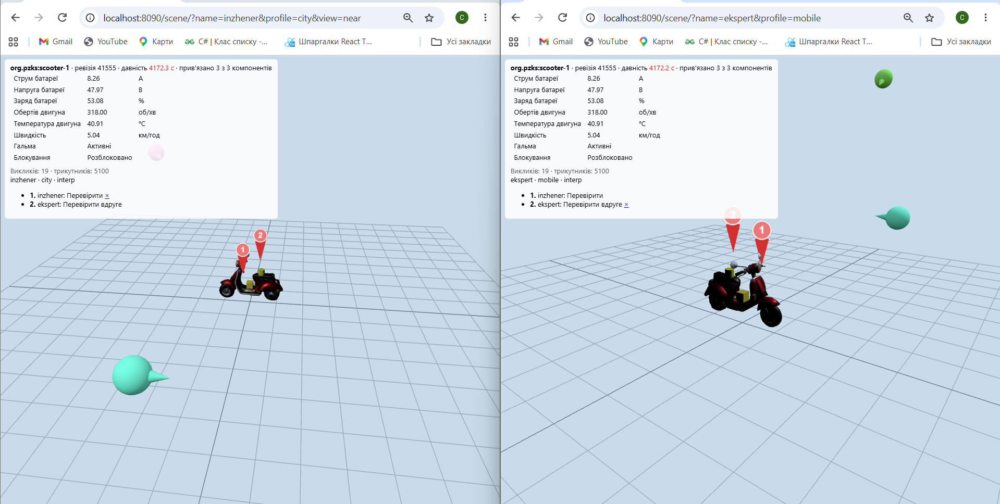

# Багатокористувацьке імерсивне середовище

## Спільний стан

У багатокористувацькому середовищі спільний стан поділяється на стан учасників, спільні позначки та стан цифрового двійника електроскутера.

| Складник | Як змінюється | Чи можна пропустити оновлення | Джерело істини |
|---|---|---|---|
| Положення учасника | Оновлюється під час переміщення камери в 3D-сцені | Так, використовується останнє актуальне значення | Клієнт-власник; сервер перевіряє координати та пересилає іншим учасникам |
| Орієнтація учасника | Оновлюється під час обертання камери | Так, використовується останнє актуальне значення | Клієнт-власник; сервер перевіряє та пересилає іншим учасникам |
| Позначки на сцені | Створюються та видаляються учасниками | Ні, операції створення та видалення мають бути синхронізовані | Сервер сеансу: перевіряє, призначає ідентифікатори та дозволяє видалення лише автору |
| Присутність учасників | Змінюється під час підключення та відключення клієнтів | Ні, зміни присутності мають бути відображені в інших клієнтів | Сервер сеансу |
| Стан електроскутера | Оновлюється телеметрією: швидкість, оберти двигуна, струм, напруга, температура, заряд батареї, стан гальм і блокування | Так, проміжні значення можуть агрегуватися відповідно до частоти оновлення сигналу | Eclipse Ditto та джерело телеметрії |

Синхронізація використовує гібридну модель авторитетності. Кожен клієнт є джерелом власної позиції та орієнтації, а сервер перевіряє отримані координати й пересилає їх іншим учасникам. Сервер сеансу є авторитетним джерелом позначок: він перевіряє запити, призначає ідентифікатори та контролює право видалення.

Стан цифрового двійника електроскутера не передається через сервер сеансу. Кожен клієнт отримує телеметрію безпосередньо від платформи Eclipse Ditto, як реалізовано в попередній лабораторній роботі.

## Архітектура синхронізації

Для обміну спільним станом використовується WebSocket-сервер на порту 8091. Сервер формує знімки стану з періодом 50 мс (20 Гц) та надсилає кожному клієнту позиції інших учасників без його власної позиції.

Для моделювання мережевих умов передбачено три профілі: локальна мережа (LAN), міська широкосмугова мережа (City) та мобільна мережа (Mobile). Модель враховує затримку, джитер і ймовірність повторного передавання втраченого сегмента TCP.

## Реалізація та перевірка

Для забезпечення одночасної роботи декількох клієнтів реалізовано багатокористувацький режим цифрового двійника електроскутера на основі WebSocket.

Для перевірки роботи режиму спочатку запущено WebSocket-сервер:
`node session/server.js`
Після чого в окремому терміналі запущено тестового бота, який генерує рух за заданою траєкторією:
`node session/bot.js`
Далі відкрито два браузерні клієнти з різними іменами учасників:

- `http://localhost:8090/scene/?name=inzhener&profile=city&view=near`
- `http://localhost:8090/scene/?name=ekspert&profile=mobile`

У результаті створено спільний сеанс, у якому одночасно беруть участь два користувачі та тестовий бот.

Модуль `scene/net.js` передає позицію та орієнтацію камери кожного учасника з частотою 20 разів на секунду. Отримані від сервера дані використовуються для відображення інших учасників у вигляді тривимірних аватарів, що складаються з голови та конуса, який показує напрямок погляду.

Для відображення руху застосовано інтерполяцію або екстраполяцію між отриманими знімками стану залежно від вибраного режиму та мережевого профілю.

*Рис. 3 – Одночасна робота двох клієнтів у багатокористувацькому режимі*

## Спільні позначки

Реалізовано механізм створення та видалення спільних позначок. Подвійне клацання по сцені дає змогу додати позначку з текстовим описом і координатами у тривимірному просторі.

Позначки відображаються у вигляді червоних конусів із номерами. На інформаційній панелі кожному номеру відповідає запис із зазначенням автора та тексту. Автор може видалити власну позначку за допомогою елемента «×».

Зміни передаються через сервер усім підключеним клієнтам, тому створення та видалення позначок синхронізується між учасниками.

## Сценарій
### Сценарій роботи кількох учасників

У багатокористувацькому сеансі одночасно працюють три учасники: інженер (`inzhener`), експерт (`ekspert`) та програмний бот (`bot`). Інженер оглядає цифрову модель електроскутера, переміщує камеру та створює позначки на окремих компонентах. Експерт спостерігає за діями інженера, переміщує власну камеру та переглядає створені позначки. Бот автоматично рухається заданою траєкторією та передає оновлення власної пози й орієнтації.

- Інженер переглядає цифровий двійник електроскутера та створює позначки щодо компонентів, які потребують перевірки.
- Експерт одночасно переглядає ту саму сцену, бачить аватар інженера та отримує створені ним позначки.
- Експерт може створювати власні позначки, а також переглядати позначки інженера.
- Бот генерує рух за відомою траєкторією та використовується для подальшого вимірювання точності синхронізації.

Спільний стан охоплює позиції та орієнтації учасників, їхню присутність у сеансі, а також створені позначки з текстом, координатами й авторством. Оновлення передаються через WebSocket-сервер. Позначку може видалити лише її автор. Стан телеметрії електроскутера надходить окремо з цифрового двійника.

### Вимірювання мережевого потоку

Для оцінювання мережевого навантаження використано вбудовану статистику WebSocket-сервера, яка кожні п'ять секунд виводить кількість активних учасників і вихідний потік \(R_c\). Під час вимірювання одночасно працювали два браузерні клієнти (`inzhener`, `ekspert`) та програмний бот (`bot`) — загалом три учасники.

Для аналізу вибрано п'ять послідовних вимірювань зі стабільної ділянки роботи сервера:

| № | Кількість учасників \(N\) | Вихідний потік \(R_c\), кбіт/с |
|---:|---:|---:|
| 1 | 3 | 109,6 |
| 2 | 3 | 109,8 |
| 3 | 3 | 109,0 |
| 4 | 3 | 108,5 |
| 5 | 3 | 113,1 |
| **Середнє** | **3** | **110,0** |

Середнє значення обчислено за формулою:

$$
R_{c,\text{сер}} =
\frac{109{,}6+109{,}8+109{,}0+108{,}5+113{,}1}{5}
= 110{,}0\text{ кбіт/с}.
$$

Для теоретичної оцінки використовується формула з лекції 11:

$$
R_c = 8 \cdot N \cdot K \cdot f \cdot s,
$$

де \(N=3\) — кількість учасників, \(K=2\) — кількість інших учасників, яким передається оновлення стану кожного учасника, \(f=20\) Гц — частота передавання пози, \(s\) — розмір одного запису стану в байтах.

Після підстановки відомих параметрів:

$$
R_c = 8 \cdot 3 \cdot 2 \cdot 20 \cdot s = 960s.
$$

За виміряного середнього потоку \(110{,}0\) кбіт/с можна оцінити ефективний розмір запису:

$$
s \approx \frac{110000}{960} \approx 114{,}6\text{ байта}.
$$

Отже, виміряний потік становить у середньому 110,0 кбіт/с для трьох учасників. Отримана оцінка \(s\) є розрахунковою, а не безпосередньо виміряним розміром повідомлення. Відхилення реального потоку від спрощеної теоретичної моделі можуть бути пов'язані зі структурою повідомлень, службовими даними протоколу та особливостями передавання оновлень.

## Результат

Перевірено одночасну роботу двох браузерних клієнтів і тестового бота. Учасники бачать аватари один одного, а створені позначки синхронізуються між клієнтами. Видалення власної позначки призводить до її зникнення в усіх учасників сеансу.

## Крок 11. Моделювання мережевих затримок та інтерполяція

Для перевірки впливу мережевих затримок виконано чотири вимірювання: три
з інтерполяцією для профілів LAN, City і Mobile та одне з екстраполяцією
для профілю Mobile. У кожному випадку тривалість вимірювання становила
60 секунд.

Результати збережено у файлах `results/net-*.json`.

| Профіль | Режим | RTT p50, мс | Delay p50, мс | Delay p95, мс | Off max, м | Starved, % |
|---|---|---:|---:|---:|---:|---:|
| LAN | Інтерполяція | 31 | 104 | 126 | 0,002 | 32,4 |
| City | Інтерполяція | 34 | 162 | 182 | 0,002 | 0 |
| Mobile | Інтерполяція | 110 | 208 | 236 | 0,002 | 0,1 |
| Mobile | Екстраполяція | 109 | 90 | 96 | 0,119 | 100 |

За результатами інтерполяційних вимірювань зі збільшенням мережевої
затримки зростає затримка відображення: від 126 мс за p95 для LAN
до 236 мс для Mobile. При цьому максимальне відхилення від заданої
траєкторії в усіх трьох режимах становить лише 0,002 м.

Для профілю Mobile екстраполяція зменшила затримку відображення
до 96 мс за p95, однак максимальне відхилення зросло до 0,119 м.
Отже, екстраполяція забезпечує швидше відображення руху, але поступається
інтерполяції за точністю відтворення траєкторії.

Для LAN зафіксовано підвищене значення `starved_pct` — 32,4%, тоді як
для City і Mobile цей показник становить 0% та 0,1% відповідно.
У режимі екстраполяції він дорівнює 100%. Ці відмінності відображають
особливості отриманих вимірювань і враховуються під час порівняння
режимів. Показник `starved_pct` для екстраполяції не слід безпосередньо
порівнювати з інтерполяційними результатами.

Під час реалізації враховано типову помилку синхронізації фаз:
бот надсилає оновлення позиції з періодом 49 мс, тоді як сервер
формує знімки стану кожні 50 мс. Завдяки різним періодам фаза
між надсиланням позицій і формуванням знімків поступово змінюється.

Таким чином, інтерполяція забезпечує точніше відтворення руху за рахунок
додаткової затримки, тоді як екстраполяція зменшує затримку відображення,
але збільшує похибку положення.

## Профілі мережі

Для оцінювання поведінки багатокористувацького середовища зіставлено розрахункові та виміряні затримки для трьох мережевих профілів.

Віддалений аватар відображається в минулому — у момент часу $t-D_{\text{інт}}$. Для плавного відтворення руху використовуються два знімки сервера, між якими перебуває цей момент. Затримка інтерполяції має враховувати період надходження знімків, можливі втрати та джитер. Відповідно до виразу (5) вона визначається як:

$$
D_{\text{інт}} \geq (m+1)\cdot T_{\text{зн}}+J.
$$

Затримка, з якою учасник Б бачить дію учасника А, визначається за виразом (6):

$$
L_{\text{АБ}}=L_{\uparrow}+t_{\text{оч}}+L_{\downarrow}+D_{\text{інт}}.
$$

Тут:
- $m$ — кількість послідовно втрачених знімків;
- $T_{\text{зн}}$ — період надходження знімків;
- $J$ — джитер;
- $L_{\uparrow}$ — затримка передавання від учасника А до сервера;
- $L_{\downarrow}$ — затримка передавання від сервера до учасника Б;
- $t_{\text{оч}}$ — середній час очікування формування наступного знімка;
- $D_{\text{інт}}$ — затримка інтерполяції.

Значення $D_{\text{інт}}$ взято з результатів роботи вимірювального модуля для відповідного мережевого профілю. У режимі екстраполяції затримка інтерполяції не застосовується, тому $D_{\text{інт}}=0$.

У роботі використано період знімків $T_{\text{зн}}=50$ мс, що відповідає частоті 20 Гц. Середній час очікування становить:

$$
t_{\text{оч}}=\frac{T_{\text{зн}}}{2}=25\text{ мс}.
$$

Бот працює в локальній мережі, тому прийнято $L_{\uparrow}=1$ мс. Для спостерігача затримка передавання визначається як половина модельного RTT:

$$
L_{\downarrow}=\frac{RTT_{\text{модель}}}{2}.
$$

За виразом (5) у вимірювальному модулі отримано такі значення затримки інтерполяції: 51 мс для LAN, 105 мс для City та 130 мс для Mobile. Для режиму екстраполяції $D_{\text{інт}}=0$.

Розрахункова затримка визначається за виразом (6). Результати розрахунків і вимірювань наведено в таблиці.

| Профіль, режим | RTT модель / вимір, мс | $D_{\text{інт}}$, мс | $L_{\text{АБ}}$, мс | Затримка p50 / p95, мс | Без новішого знімка, % | Відхилення, см |
|---|---:|---:|---:|---:|---:|---:|
| LAN, інтерполяція | 2 / 31 | 51 | 78 | 104 / 126 | 32,4 | 0,2 |
| City, інтерполяція | 20 / 34 | 105 | 141 | 162 / 182 | 0 | 0,2 |
| Mobile, інтерполяція | 60 / 110 | 130 | 186 | 208 / 236 | 0,1 | 0,2 |
| Mobile, екстраполяція | 60 / 109 | 0 | 56 | 90 / 96 | 100 | 11,9 |

Розрахункова затримка для профілів LAN, City та Mobile становить 78, 141 і 186 мс відповідно. Для екстраполяції вона становить 56 мс, оскільки затримка інтерполяції відсутня.

Виміряна медіана затримки перевищує розрахункове значення за виразом (6) на 26 мс для LAN, 21 мс для City, 22 мс для Mobile та 34 мс для екстраполяції. Отже, розрахункова модель відображає основні складники затримки, але не враховує всіх витрат реального обміну повідомленнями. Розбіжність зумовлена джитером, повторними передаваннями TCP-сегментів та додатковими витратами на оброблення й передавання даних.

В інтерполяційних режимах максимальне відхилення від заданої траєкторії становить 0,2 см. Для екстраполяції затримка p95 зменшується до 96 мс, однак максимальне відхилення зростає до 11,9 см. Таким чином, інтерполяція забезпечує точніше відображення руху, тоді як екстраполяція зменшує затримку за рахунок збільшення похибки положення.

Примітка. Значення 100% для екстраполяції не можна безпосередньо порівнювати з результатами інтерполяції, оскільки цей режим не очікує надходження новішого знімка, а прогнозує положення за наявними даними. Для LAN значення 32,4% зафіксовано під час вимірювання; воно вказує на те, що частина кадрів відображалася без новішого знімка.

## Архітектурні обмеження

1. **Залежність взаємодії від мережевого профілю.** Для LAN затримка p95 становить 126 мс, для City — 182 мс, для Mobile — 236 мс. Тому локальна мережа найкраще підходить для взаємодії, чутливої до затримки, а профілі City і Mobile — переважно для спільного огляду моделі та роботи з позначками. Екстраполяція в Mobile зменшує затримку p95 до 96 мс, але збільшує максимальне відхилення до 11,9 см.

2. **Обмеження транспортного протоколу.** WebSocket використовує TCP, що забезпечує надійне та впорядковане доставлення повідомлень. Це важливо для синхронізації позначок і присутності учасників. Водночас повторне передавання втрачених сегментів може затримувати актуальні оновлення позицій. Альтернативою для передавання позицій може бути WebRTC DataChannel у невпорядкованому режимі з вимкненою гарантією доставлення. У такому випадку пріоритетом стає отримання актуального стану, а не доставлення кожного проміжного оновлення.

3. **Масштабування кількості учасників.** Сервер пересилає оновлення кожного учасника іншим учасникам, тому кількість передавань зростає пропорційно до \(N(N-1)\). За трьох учасників виміряний вихідний потік становив у середньому 110,0 кбіт/с. Для більшої кількості учасників навантаження на сервер і мережу зростатиме. Для масштабування доцільно застосувати *interest management* — передавання оновлень лише тим клієнтам, для яких відповідні об'єкти перебувають у зоні інтересу.

4. **Відмова сервера сеансу.** WebSocket-сервер є центральним вузлом синхронізації. У разі його відмови припиняється обмін позиціями, оновленнями присутності та спільними позначками. Локальне відображення сцени може залишатися доступним, але спільний стан більше не оновлюється. Для підвищення відмовостійкості необхідно передбачити повторне підключення клієнтів і відновлення стану сеансу.

5. **Безпека команд фізичного об'єкта.** Канал синхронізації сцени призначений для передавання стану учасників і спільних позначок, а не для безпосереднього керування електроскутером. Передавання команд фізичному об'єкту через цей канал без додаткових перевірок є небезпечним. Необхідно перевіряти права доступу, виключність керування, актуальність команди та підтвердження її виконання. Керування фізичним об'єктом має здійснюватися через окремий захищений механізм взаємодії з цифровим двійником.