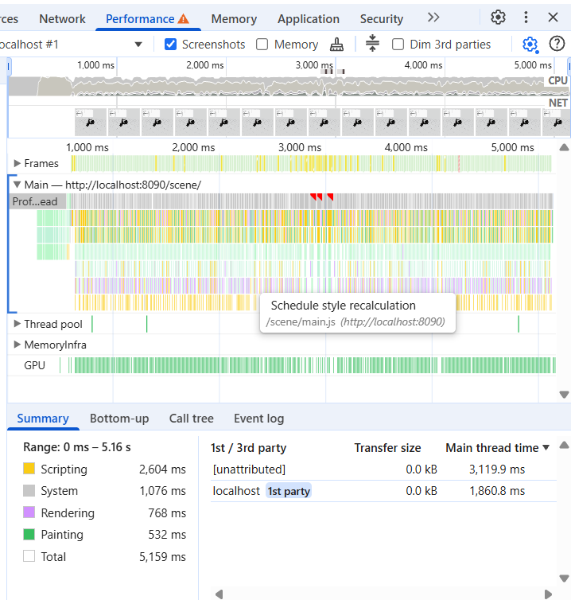
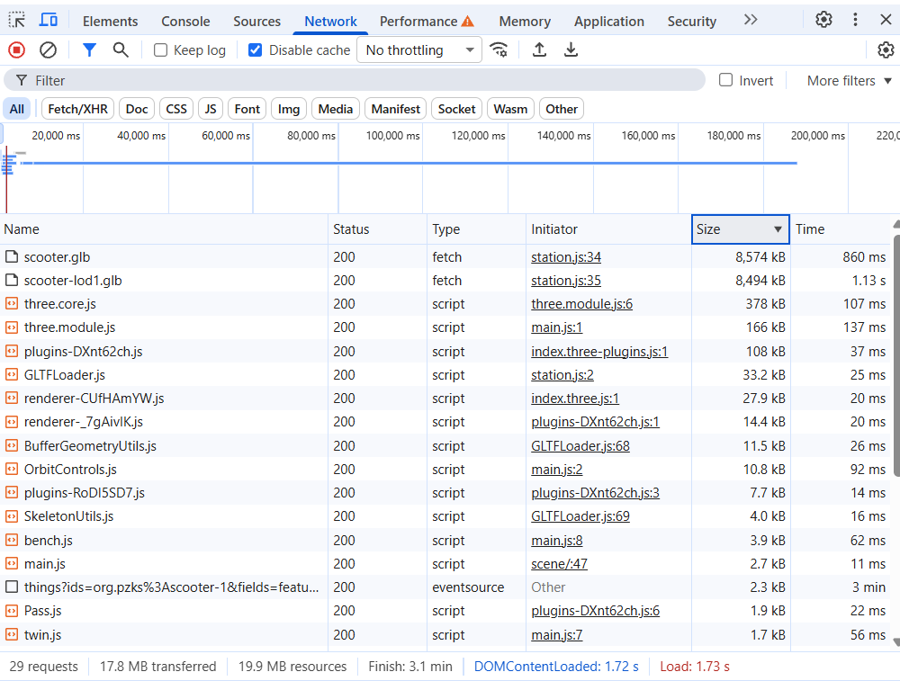

## Бюджет продуктивності

Цільовим пристроєм є ноутбук Acer Aspire A515-45 із процесором AMD Ryzen 5 5500U, інтегрованою графікою AMD Radeon(TM) Graphics та 8 ГБ оперативної пам'яті (7,35 ГБ фізичної пам'яті за даними ОС).

Цільова частота оновлення — 60 Гц, бюджет одного кадру — 16,7 мс.

| Показник | Ціль | Підстава | Поле результату |
|---|---:|---|---|
| Частка кадрів у бюджеті | ≥ 99% кадрів з max(TCPU, TGPU) ≤ 16,7 мс | Acer Aspire A515-45, цільова частота 60 Гц | `in_budget_pct` |
| Виклики малювання за кадр | ≤ 50 | Модельне: (16,7 − 6) / 0,2 ≈ 53; передбачено резерв | `calls_max` |
| Трикутники за кадр | ≤ 300 000 | Модельне: орієнтир для інтегрованої графіки | `triangles_max` |
| Пам'ять текстур | ≤ 16 МБ | Модельне: обмеження ресурсів браузерної вкладки | `textures_mb` |
| Дані до першого кадру | ≤ 1,9 МБ | Модельне: 3 секунди за швидкості 5 Мбіт/с | `data_first_frame_mb` |

Час CPU вимірюється з використанням емуляції уповільнення процесора в інструментах розробника браузера. Час GPU вимірюється на реальному адаптері AMD Radeon(TM) Graphics без емуляції уповільнення графічного процесора.

## Профілювання

Базове профілювання виконано в браузері Chrome на Windows за роздільної здатності 1920 × 1080. Умови тестування: 6-кратне уповільнення CPU, 3 секунди прогріву та 30 секунд вимірювання. Камера автоматично облітала сцену на відстані від 8 до 308 м. GPU-час вимірювався за допомогою `EXT_disjoint_timer_query_webgl2`.

### Результати базового вимірювання

Результати автоматичного профілювання збережено у файлі `results/perf-before.json`.

| Показник | p50 | p99 | Мінімум | Максимум |
|---|---:|---:|---:|---:|
| Інтервал між кадрами, мс | 16,7 | 17,2 | 0 | 233,2 |
| TCPU, мс | 0,5 | 1,4 | 0,1 | 157,6 |
| TGPU, мс | 0,03 | 0,95 | 0,02 | 397,15 |
| Виклики малювання | 2 | 11 | 1 | 11 |
| Трикутники | 12 | 2920 | 0 | 2920 |

За 30 секунд отримано 1774 кадри. Частка кадрів, для яких `max(TCPU, TGPU) ≤ 16,7 мс`, становить 99,94%, що відповідає встановленій цілі (не менше 99%).

За оцінкою модуля профілювання виявлено 19 текстур із сумарним розрахунковим обсягом 405,33 МБ. Resource Timing API зафіксував 21 запит загальним обсягом 17,01 МБ на момент початку вимірювального інтервалу після прогріву. Це значення характеризує завантажені на той момент ресурси, а не окремо виміряний обсяг до першого кадру.

### Запис панелі Performance

Додатково виконано запис тривалістю 5,16 с у панелі Performance. На доріжці Main спостерігається активність основного потоку, а на доріжці GPU — регулярна графічна активність.

У підсумку запису зафіксовано:
- Scripting — 2604 мс;
- System — 1076 мс;
- Rendering — 768 мс;
- Painting — 532 мс.

Ці значення відображають сумарний розподіл часу за вибраний інтервал, а не перцентилі часу одного кадру.



### Аналіз мережевих запитів

За результатами профілювання у вкладці Network виявлено 29 запитів із загальним обсягом переданих даних 17,8 МБ (обсяг ресурсів — 19,9 МБ).

Найбільшими ресурсами є 3D-моделі електроскутера:
- `scooter.glb` — 8,574 kB;
- `scooter-lod1.glb` — 8,494 kB.

Спрощена модель містить на 26,4% менше трикутників порівняно з детальною, проте її файл майже не відрізняється за розміром. Зменшення кількості трикутників не забезпечило пропорційного зменшення розміру GLB-файлу. Це вказує на необхідність окремої оптимізації геометрії, текстур та інших вбудованих ресурсів моделі.

Також зафіксовано запит типу `EventSource` до Ditto для отримання оновлень стану цифрового двійника `org.pzks:scooter-1`. Він використовує Server-Sent Events (SSE), а не WebSocket, і забезпечує передавання змін стану в браузер.

**Мережеві запити сцени до оптимізації:**



### Виявлені вузькі місця

| Показник | Результат і причина | Запланована оптимізація | Очікуваний вплив |
|---|---|---|---|
| Пам'ять текстур | 405,33 МБ за оцінкою для 19 текстур, що перевищує бюджет 16 МБ | Визначення найбільших текстур, зменшення їхньої роздільної здатності, перехід на стиснений формат KTX2/Basis | Зменшення використання пам'яті текстур |
| Обсяг завантажених ресурсів | 17,8 МБ переданих даних за Network; два великі GLB-файли становлять основну частину обсягу | Оптимізація GLB і текстур, відкладене завантаження спрощеної моделі за потреби | Зменшення мережевого трафіку та часу початкового завантаження |
| Розмір LOD1 | 8,494 kB; зменшення кількості трикутників на 26,4% майже не вплинуло на розмір файлу | Окрема оптимізація геометрії та вбудованих ресурсів спрощеної моделі | Зменшення розміру спрощеної моделі |
| Інтервал між кадрами | p99 становить 17,2 мс, що трохи перевищує бюджет 16,7 мс; водночас 99,94% кадрів вкладаються в бюджет | Перевірка поодиноких затримок на доріжці Main та оптимізація тривалих завдань JavaScript за потреби | Підвищення стабільності частоти кадрів |

Кількість викликів малювання (p99 — 11) і трикутників (p99 — 2920) перебуває в межах установлених бюджетів. За виміряними перцентилями TCPU (1,4 мс) і TGPU (0,95 мс) обчислювальне навантаження рендерингу не є основним вузьким місцем базової сцени.

### Висновок

Базова сцена забезпечує виконання цільової вимоги щодо частки кадрів у бюджеті 16,7 мс. Основними напрямами подальшої оптимізації визначено зменшення обсягу текстур і мережевих ресурсів, а також оптимізацію спрощеної моделі LOD1. Після оптимізації буде виконано повторне профілювання за тих самих умов і порівняння результатів із базовим вимірюванням.

## Крок 7. Застосування оптимізацій 3D-сцени

На сьомому кроці реалізовано три оптимізації 3D-сцени цифрового двійника електроскутера: спрощення геометрії, стиснення текстур у формат KTX2 та відкладене завантаження детальної моделі. Кожна оптимізація вмикається окремим значенням параметра `opt`, що дозволяє оцінити її вплив незалежно від інших.

### Реалізація оптимізацій

**Спрощення геометрії (`simp`).** За допомогою `gltfpack` створено спрощену версію моделі електроскутера зі зменшенням кількості трикутників. Для цього використано параметр `-si 0.25`, який задає цільове співвідношення кількості трикутників. Спрощена модель використовується як детальний рівень геометрії в оптимізованому варіанті сцени.

**Стиснення текстур (`ktx2`).** Реалізовано конвертацію текстур моделей glTF у формат KTX2 зі стисненням Basis Universal ETC1S. Для перетворення створено сценарій `scene/tools/ktx2.mjs` на основі бібліотеки `ktx2-encoder`. У сцені використовується `KTX2Loader` з визначенням підтримуваного графічним пристроєм формату текстур.

**Відкладене завантаження (`defer`).** Реалізовано початкове відображення сцени зі спрощеною моделлю електроскутера. Після першого кадру завантажується детальна модель, яка замінює спрощену. Таким чином, відображення початкового кадру не очікує завершення завантаження детальної моделі. У поточній реалізації відкладене завантаження застосовано до детальної моделі, але не до тайлів рельєфу.

**Інстансування (`inst`).** Цю оптимізацію не застосовано, оскільки досліджувана модель представляє один електроскутер, а не групу з восьми однакових агрегатів, як у прикладі методичних рекомендацій. Тому інстансування не має відповідного практичного застосування для поточної структури 3D-сцени. Вимогу щодо реалізації щонайменше трьох оптимізацій виконано.

### Зміни у файлах проєкту

У межах реалізації оптимізацій внесено такі зміни:

| Файл або каталог | Призначення |
|---|---|
| `scene/station.js` | Реалізація вибору спрощеної моделі, завантаження текстур KTX2 та відкладеного завантаження детальної моделі |
| `scene/main.js` | Передавання рендерера до функції завантаження сцени та запуск відкладеного завантаження після першого кадру |
| `scene/tools/ktx2.mjs` | Сценарій конвертації моделей glTF у формат KTX2 |
| `scene/models/` | Збереження оптимізованих версій моделей |
| `results/` | Збереження результатів профілювання базової та оптимізованих версій сцени |

Для окремих оптимізацій створено такі моделі: `scooter-s.glb`, `scooter-ktx2.glb`, `scooter-lod1-ktx2.glb` та `scooter-s-ktx2.glb`.

### Результати вимірювань

Для оцінювання впливу оптимізацій проведено окремі 30-секундні вимірювання з трисекундним прогрівом за тих самих налаштувань, що й на попередньому кроці. Результати збережено у файлах `perf-before.json`, `perf-simp.json`, `perf-ktx2.json` та `perf-defer.json`.

| Показник | Без оптимізації | `simp` | `ktx2` | `defer` |
|---|---:|---:|---:|---:|
| Кадри у бюджеті, % | 99,94 | 99,94 | 99,94 | 100 |
| CPU p99, мс | 1,4 | 2,4 | 1,5 | 1,7 |
| GPU p99, мс | 0,95 | 1,13 | 0,72 | 1,19 |
| Виклики рендерингу p99 | 11 | 11 | 11 | 11 |
| Трикутники p99 | 2920 | 2148 | 2920 | 2920 |
| Оцінка пам'яті текстур, МБ | 405,33 | 682,67 | 304 | 405,33 |
| Ресурси за Resource Timing, МБ | 17,01 | 8,87 | 1,03 | 17,04 |

Спрощення геометрії зменшило кількість трикутників з 2920 до 2148, тобто приблизно на 26,4%. Обсяг ресурсів, зафіксований Resource Timing, зменшився з 17,01 до 8,87 МБ.

Стиснення текстур KTX2 забезпечило найбільше скорочення обсягу завантажених ресурсів: з 17,01 до 1,03 МБ. Значення GPU p99 зменшилося з 0,95 до 0,72 мс. Розрахункова оцінка пам'яті текстур зменшилася з 405,33 до 304 МБ. Цей показник є оцінкою інструмента профілювання, а не безпосереднім вимірюванням фактичного використання відеопам'ят

Оптимізацію `inst` не реалізовано, оскільки тривимірна сцена містить один електроскутер, а не групу однакових агрегатів. Інстансування в такій конфігурації не забезпечило б очікуваного скорочення кількості викликів малювання. Замість цього застосовано три оптимізації, актуальні для структури сцени: спрощення геометрії (simp), стиснення текстур (ktx2) та відкладене завантаження детальної моделі (defer).

## Опитимізація
### Повторне вимірювання та перевірка бюджету продуктивності

Після реалізації оптимізацій виконано повторне профілювання сцени з одночасним використанням спрощеної геометрії, текстур KTX2 та відкладеного завантаження детальної моделі. Для цього використано параметри `bench=30&label=after&opt=ktx2,simp,defer`. Інстансування (`inst`) не застосовувалося через відсутність у сцені повторюваних однакових агрегатів.

Вимірювання виконано за тих самих умов, що й базове профілювання: Chrome 157, роздільна здатність 1920 × 1080, уповільнення CPU 6×, прогрів 3 секунди та тривалість вимірювання 30 секунд. Результати збережено у файлі `results/perf-after.json`.

### Порівняння показників до і після оптимізації

| Показник | Бюджет | До | `simp` | `ktx2` | `defer` | Після |
|---|---:|---:|---:|---:|---:|---:|
| Кадри в бюджеті, % | ≥ 99 | 99,94 | 99,94 | 99,94 | 100 | 99,94 |
| CPU p50 / p99, мс | — | 0,5 / 1,4 | 0,5 / 2,4 | 0,4 / 1,5 | 0,4 / 1,7 | 0,5 / 2,4 |
| GPU p50 / p99, мс | — | 0,03 / 0,95 | 0,03 / 1,13 | 0,04 / 0,72 | 0,04 / 1,19 | 0,04 / 1,00 |
| Виклики малювання, максимум | ≤ 50 | 11 | 11 | 11 | 11 | 11 |
| Трикутники, максимум | ≤ 300 000 | 2920 | 2148 | 2920 | 2920 | 2148 |
| Оцінка пам'яті текстур, МБ | ≤ 16 | 405,33 | 682,67 | 304 | 405,33 | 512 |
| Ресурси за Resource Timing, МБ | ≤ 1,9* | 17,01 | 8,87 | 1,03 | 17,04 | 1,03 |

*Показник Resource Timing у цій реалізації фіксується на початку вимірювального інтервалу, після трисекундного прогріву. Він характеризує обсяг переданих ресурсів, зафіксованих на цей момент, а не безпосередньо обсяг даних до першого відображеного кадру.*

### Аналіз результатів

Після комбінування оптимізацій отримано 1797 кадрів за 30 секунд. Частка кадрів, для яких максимальний час CPU та GPU не перевищував 16,7 мс, становить 99,94%. Таким чином, ціль щодо частки кадрів у бюджеті виконана.

Максимальна кількість викликів малювання становить 11 за встановленого обмеження 50. Максимальна кількість трикутників — 2148 за бюджету 300 000. Обидва показники перебувають у межах цільових значень.

Обсяг ресурсів, зафіксований Resource Timing після прогріву, зменшився з 17,01 МБ до 1,03 МБ. Це відповідає скороченню приблизно на 94% порівняно з базовим вимірюванням. Результат узгоджується з використанням стиснених текстур KTX2 та оптимізованих моделей.

CPU p99 після комбінування оптимізацій становить 2,4 мс, GPU p99 — 1,00 мс. Порівняно з базовим вимірюванням ці значення дещо зросли. Отже, оптимізації не забезпечили додаткового зменшення часу обробки кожного кадру, проте обчислювальні показники залишаються значно нижчими за бюджет 16,7 мс.

Оцінка пам'яті текстур після оптимізації становить 512 МБ, що формально перевищує встановлений бюджет 16 МБ. Однак цей показник потребує окремого уточнення. Функція `estimateTextureMemory()` у профілювальнику розраховує розмір текстур за формулою RGBA8 (`width × height × 4`) з урахуванням mip-рівнів, незалежно від фактичного формату зберігання текстури. Тому вона не враховує переваги GPU-стиснення KTX2. Крім того, підрахунок охоплює текстури всіх завантажених рівнів LOD, зокрема моделей, які не відображаються в поточному кадрі. Через це отримане значення не є достовірним вимірюванням фактичного використання відеопам'яті для стиснених текстур.

### Висновок

Після застосування трьох оптимізацій підтверджено виконання чотирьох показників продуктивності: частки

## Додаткова оптимізація геометрії за допомогою Meshopt

Для зменшення обсягу 3D-моделей було застосовано розширення `EXT_meshopt_compression`, яке забезпечує стиснення геометричних даних glTF/GLB. Для цього використано інструмент `gltfpack`.

Інструмент встановлено як залежність розробки проєкту:

```bash
npm install --save-dev gltfpack
```

Стиснення виконано для детальної моделі електроскутера та її спрощеного варіанта LOD1:

```bash
npx gltfpack -i models/scooter.glb -o models/scooter-meshopt.glb -cc -ke -kn -km
npx gltfpack -i models/scooter-lod1.glb -o models/scooter-lod1-meshopt.glb -cc -ke -kn -km
```

Параметр `-cc` вмикає стиснення геометрії з використанням `EXT_meshopt_compression`. Параметри `-ke`, `-kn` і `-km` забезпечують збереження додаткових даних, назв вузлів і матеріалів.

Після обробки було перевірено структуру отриманих GLB-файлів. В обох моделях у списку `extensionsUsed` присутнє розширення `EXT_meshopt_compression`. Також перевірено збереження додаткового ідентифікатора `extras.element`, який використовується для зв'язування частин 3D-моделі з елементами цифрового двійника.

### Порівняння обсягу моделей

Розмір файлів виміряно командою `wc -c`:

| Модель | До стиснення | Після стиснення | Економія |
|---|---:|---:|---:|
| Детальна модель | 8 573 568 Б | 8 470 892 Б | 102 676 Б (1,20%) |
| LOD1 | 8 493 792 Б | 8 464 700 Б | 29 092 Б (0,34%) |

Сумарний обсяг двох моделей зменшився з 17 067 360 до 16 935 592 байтів, тобто на 131 768 байтів (приблизно 0,77%).

Отримана економія обсягу є невеликою. Це пояснюється тим, що Meshopt стискає геометричні дані, тоді як значну частину загального розміру GLB можуть займати текстури та інші ресурси, на які це стиснення безпосередньо не впливає.

Таким чином, було сформовано стиснені версії обох моделей, підтверджено використання `EXT_meshopt_compression`, збереження необхідних додаткових ідентифікаторів та виміряно зміну обсягу файлів.

**Подальші напрями вдосконалення.** Наступним кроком може бути інтеграція `MeshoptDecoder` у `GLTFLoader` бібліотеки Three.js для завантаження та декодування стиснених моделей безпосередньо у 3D-сцені. Це дозволить перевірити практичну сумісність отриманих GLB-файлів із середовищем візуалізації, а також порівняти час завантаження та вплив оптимізації на продуктивність сцени.