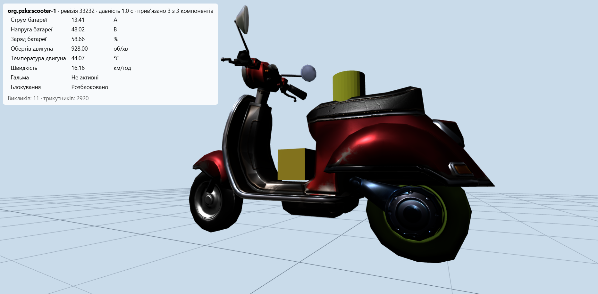

# 3D-сцена цифрового двійника

## Модель і ідентифікатори

Для побудови тривимірної сцени використано готову модель електроскутера *Scooter Motorcycle* автора NORBERTO-3D.

- Джерело: https://sketchfab.com/3d-models/scooter-motorcycle-53474287ff1045e49f82819f50b8736f
- Автор: NORBERTO-3D.
- Ліцензія: Creative Commons Attribution 4.0 International (CC BY 4.0).
- Формат моделі: glTF Binary (`.glb`).

Модель підготовлено для використання в цифровому двійнику: окремим логічним вузлам призначено ідентифікатори `extras.element`.

Для оптимізації геометрії створено спрощений рівень деталізації за допомогою `gltfpack`:

```bash
npx gltfpack -i models/scooter.glb -o models/scooter-lod1.glb -si 0.1 -kn -ke
```

Параметр `-si 0.1` задає цільовий коефіцієнт спрощення, `-kn` зберігає імена вузлів, а `-ke` — додаткові властивості `extras`.

Результати вимірювання:

| Показник | Детальна модель | Спрощена модель (LOD1) |
|---|---:|---:|
| Файл | `scooter.glb` | `scooter-lod1.glb` |
| Кількість трикутників | 2 920 | 2 148 |
| Розмір | 8 372,6 КБ | 8 294,7 КБ |

Спрощення зменшило кількість трикутників приблизно на 26,4%. Розмір файлу зменшився незначно, оскільки оптимізація геометрії не обов'язково суттєво зменшує обсяг текстур та інших ресурсів моделі.

### Елементи моделі та сигнали цифрового двійника

| Ідентифікатор (`extras.element`) | Деталь | Сигнал цифрового двійника |
|---|---|---|
| `scooter` | Електроскутер загалом | Загальний стан об'єкта |
| `battery` | Акумулятор | `battery.current`, `battery.voltage`, `battery.stateOfCharge` |
| `motor` | Електродвигун | `motor.rpm`, `motor.temperature` |
| `runningGear` | Заднє колесо / ходова частина | `runningGear.speed` |
| `handlebar` | Кермо | — |
| `body` | Корпус | — |
| `frontWheel` | Переднє колесо | — |

Ідентифікатори використовуються для пошуку відповідних вузлів у тривимірній сцені та прив'язування телеметрії цифрового двійника. Один елемент може відповідати декільком сигналам.

### Перевірка ідентифікаторів

Для перевірки збереження ідентифікаторів після експорту та спрощення використано сценарій:

```bash
node tools/elements.mjs models/*.glb
```

Результат перевірки: обидві моделі містять сім ідентифікаторів — `battery`, `handlebar`, `body`, `frontWheel`, `motor`, `runningGear`, `scooter`.

## Прив'язка телеметрії

Для зв'язку тривимірної моделі з цифровим двійником використано таблицю прив'язки `scene/binding.json`. Вона визначає ідентифікатор вузла моделі, відповідну властивість цифрового двійника, назву показника, одиницю вимірювання та діапазон для зміни кольору.

Прив'язка реалізована за таким ланцюжком:

1. Вузол моделі glTF містить ідентифікатор `extras.element`.
2. Файл `binding.json` зіставляє цей ідентифікатор із властивістю відповідної функціональної частини цифрового двійника.
3. Модуль `twin.js` отримує стан двійника через API Eclipse Ditto та підписується на оновлення за допомогою Server-Sent Events (SSE).
4. Отримані значення відображаються в інформаційній панелі, а для визначених властивостей додатково змінюється колір відповідного елемента моделі.

Для електроскутера реалізовано такі прив'язки:

| Елемент | Властивості цифрового двійника | Візуалізація кольором |
|---|---|---|
| Акумулятор (`battery`) | Струм, напруга, рівень заряду | Рівень заряду |
| Двигун (`motor`) | Оберти, температура | Температура |
| Ходова частина (`runningGear`) | Швидкість | Швидкість |

Інші ідентифіковані вузли моделі наразі не мають окремих прив'язаних телеметричних показників.

Колір визначається нормалізованим значенням властивості в заданому діапазоні. Мінімальне значення відповідає зеленому кольору, максимальне — червоному. Для проміжних значень використовується плавний перехід між кольорами.

Для батареї кольорова індикація відображає рівень заряду, а для двигуна — температуру. Інші показники цих компонентів відображаються числовими значеннями в інформаційній панелі.

Гальма та блокування також відображаються в панелі, але як логічні стани: «Активні» / «Не активні» та «Заблоковано» / «Розблоковано».

Для уникнення одночасної зміни кольору всіх екземплярів моделі функція `paint()` створює окрему копію матеріалу перед зміною його кольору.

### Отримання та відображення стану

Початковий стан цифрового двійника отримується запитом до API Eclipse Ditto через адресу `/api/2/things`. Подальші зміни надходять через SSE, що дозволяє оновлювати показники без перезавантаження сторінки.

Інформаційна панель відображає:
- ідентифікатор цифрового двійника;
- поточну ревізію;
- давність останнього отриманого вимірювання;
- кількість прив'язаних компонентів;
- значення телеметричних показників.

Якщо давність даних перевищує 2 секунди, індикатор давності змінює колір на червоний. Це дозволяє виявити припинення надходження телеметрії.

### Результат

У результаті створено вебсцену на основі Three.js, яка відображає тривимірну модель електроскутера та пов'язує її з актуальним станом цифрового двійника Eclipse Ditto.

На інформаційній панелі відображаються вісім показників і станів, а три функціональні компоненти моделі — акумулятор, двигун і ходова частина — прив'язані до телеметрії.



*Рисунок 1 — Вебсцена цифрового двійника електроскутера з відображенням телеметрії.*

## Рівні деталізації та відсікання

Для тривимірної моделі електроскутера реалізовано чотири рівні деталізації за допомогою `THREE.LOD`:

- LOD 0 — початкова детальна модель, відстань до 15 м;
- LOD 1 — спрощена модель, від 15 м;
- LOD 2 — обмежувальний паралелепіпед, від 60 м;
- LOD 3 — порожній об'єкт, від 250 м.

Для переходів між рівнями деталізації використано гістерезис 10 %. Це зменшує ризик частого перемикання рівнів поблизу порогових відстаней.

Відсікання за пірамідою видимості виконується засобами Three.js на основі обмежувальних сфер. Для порівняння реалізовано параметр URL `cull=0`, який вимикає `frustumCulled` для об'єктів сцени. Відсікання задніх граней визначається властивістю `doubleSided: false` матеріалів glTF.

### Результати експерименту

Для перевірки відкрито шість варіантів сцени з різними положеннями камери та станами відсікання. Кількість викликів рисування і трикутників отримано з `renderer.info.render` Three.js за допомогою автоматизованого сценарію Playwright.

| Вид | Відсікання | Викликів | Трикутників | Що видно |
|---|---|---:|---:|---|
| near | так | 11 | 2920 | Детальна модель електроскутера |
| near | ні | 11 | 2920 | Детальна модель електроскутера |
| hall | так | 2 | 12 | Обмежувальний паралелепіпед |
| hall | ні | 2 | 12 | Обмежувальний паралелепіпед |
| far | так | 1 | 0 | Модель не відображається |
| far | ні | 1 | 0 | Модель не відображається |

У режимі `near` використовується початкова детальна модель. У режимі `hall` вона замінюється паралелепіпедом, що зменшує кількість трикутників із 2920 до 12. У режимі `far` використовується порожній об'єкт, тому геометрія електроскутера не відображається.

У проведеному експерименті показники для ввімкненого та вимкненого відсікання за пірамідою видимості збігаються. Це пояснюється тим, що сцена містить один агрегат — електроскутер, який у перевірених положеннях камери залишається в полі зору. Перемикання параметра `cull=0` підтверджено за значенням `frustumCulled`.

Числові результати експерименту збережено у файлі `results/lod-stats.csv`.

### Програмна реалізація

Реалізацію рівнів деталізації та відсікання розподілено між такими файлами:

- `scene/station.js` — завантаження детальної та спрощеної моделей glTF, створення `THREE.LOD`, налаштування чотирьох рівнів деталізації та гістерезису. Тут також формується обмежувальний паралелепіпед.
- `scene/main.js` — налаштування положень камери для експериментальних режимів `near`, `mid`, `hall`, `far`; керування відсіканням за пірамідою видимості через параметр `cull=0`; відображення статистики рендерингу.
- `scene/models/scooter.glb` — початкова детальна модель електроскутера.
- `scene/models/scooter-lod1.glb` — спрощена модель для другого рівня деталізації.
- `scene/tools/collect-stats.mjs` — автоматизоване відкриття шести конфігурацій сцени за допомогою Playwright та збирання показників рендерингу.
- `results/lod-stats.csv` — результати експериментального вимірювання кількості викликів рисування та трикутників.

Відсікання задніх граней задається параметрами матеріалів у glTF-моделях (`doubleSided: false`).

## Потокове завантаження геометрії

Для перевірки потокового завантаження використано синтетичний модельний рельєф території розміром 2048 × 2048 м у форматі 3D Tiles 1.1. Геометрію організовано у вигляді квадродерева з п'ятьма рівнями деталізації.

Загалом набір містить 341 тайл і 2 793 472 трикутники. Розмір згенерованого набору становить 49,50 MiB, що перевищує встановлений бюджет клієнтського кешу 32 MiB.

### Структура тайлсету

Геометрична похибка рівня визначається кроком його сітки за формулою:

\[
G_k = \frac{32}{2^k}
\]

Для листків квадродерева геометрична похибка дорівнює нулю.

| Рівень k | Розмір тайла, м | Крок сітки, м | Геометрична похибка, м | Відстань уточнення, м | Кількість тайлів |
|---:|---:|---:|---:|---:|---:|
| 0 | 2048 | 32 | 32 | 1871 | 1 |
| 1 | 1024 | 16 | 16 | 935 | 4 |
| 2 | 512 | 8 | 8 | 468 | 16 |
| 3 | 256 | 4 | 4 | 234 | 64 |
| 4 | 128 | 2 | 0 (листок) | — | 256 |
| **Разом** | | | | | **341** |

Відстані уточнення наведено для висоти екрана 1080 пікселів, поля зору 60° та цільової екранної похибки 16 пікселів.

### Реалізація потокового завантаження

Для завантаження геометрії використано бібліотеку `3d-tiles-renderer` та клас `TilesRenderer`. Він виконує перевірку видимості тайлів, уточнення рівнів деталізації відповідно до екранної похибки та керування чергою завантаження.

Основні параметри:

- цільова екранна похибка `errorTarget = 16` пікселів;
- максимальний розмір кешу — 32 MiB;
- мінімальний розмір кешу — 24 MiB;
- відсікання тайлів за пірамідою видимості;
- завантаження потрібної геометрії в міру зміни положення камери.

Для повторного експерименту цільову похибку можна змінити параметром URL `errorTarget=32`.

### Автоматизована перевірка

Для вимірювання створено сценарій `scene/tools/collect-tiles.mjs` на основі Playwright. Він автоматично відкриває сцену в чотирьох конфігураціях, очікує стабілізації завантаження та збирає статистику:

- кількість тайлів у кеші;
- частку завантажених тайлів від загальної кількості;
- кількість видимих тайлів;
- кількість відображуваних трикутників;
- використання пам'яті кешу;
- кількість успішних і невдалих мережевих запитів.

### Результати потокового завантаження

Для трьох положень камери виконано вимірювання з `errorTarget = 16`.

| Вид | Тайлів у кеші | Частка від набору | Видимих тайлів | Трикутників | Кеш, MiB |
|---|---:|---:|---:|---:|---:|
| mid | 53 / 341 | 15,5 % | 23 | 188 416 | 7,61 |
| hall | 29 / 341 | 8,5 % | 12 | 98 304 | 4,16 |
| far | 9 / 341 | 2,6 % | 7 | 57 344 | 1,29 |

Результати показують, що система завантажує лише частину загального набору геометрії, необхідну для поточного положення камери. Зі збільшенням відстані до території зменшується кількість тайлів у кеші та обсяг геометрії, що відображається.

### Вплив цільової екранної похибки

Додатково проведено порівняння двох значень `errorTarget` для виду `far`.

| Показник | errorTarget = 16 | errorTarget = 32 |
|---|---:|---:|
| Тайлів у кеші | 9 | 5 |
| Видимих тайлів | 7 | 4 |
| Трикутників | 57 344 | 32 768 |
| Кеш, MiB | 1,29 | 0,72 |
| Мережевих запитів | 10 | 6 |

Збільшення допустимої екранної похибки з 16 до 32 пікселів зменшило кількість видимих тайлів із 7 до 4, а кількість трикутників — приблизно на 42,9 %. Відповідно зменшилося використання кешу. При цьому деталізація рельєфу стала нижчою.

### Обмеження кешу

Загальний розмір набору геометрії становить 49,50 MiB, тоді як бюджет кешу обмежено 32 MiB. Тому весь набір не потрібно завантажувати одночасно.

Якщо потрібні тайли перевищують доступний бюджет, механізм LRU (Least Recently Used) може видаляти найменш нещодавно використані ресурси. Якщо такі тайли знову знадобляться після зміни положення камери, їх доведеться повторно завантажити. Таким чином, кеш обмежує використання пам'яті клієнта, дозволяючи працювати з набором геометрії, який перевищує його бюджет.

У всіх чотирьох автоматизованих сценаріях завантаження стабілізувалося, помилок JavaScript і невдалих мережевих запитів не зафіксовано.

Результати вимірювань збережено у файлах `results/tiles-stats.csv` та `results/tiles-stats.json`.