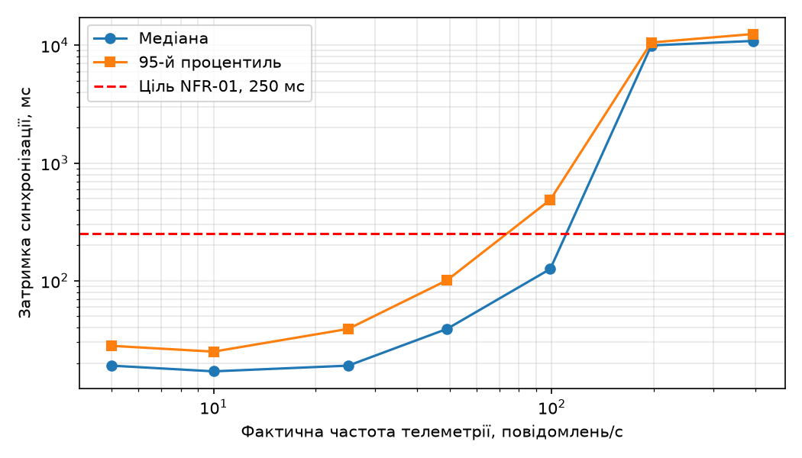

## Перевірка узгодженості

Для перевірки узгодженості стану цифрового двійника реалізовано скрипт `sync/consistency.py`, який порівнює три джерела даних:

- `results/source.csv` — телеметрію, сформовану емулятором;
- InfluxDB — історію станів цифрового двійника;
- Ditto — поточний стан цифрового двійника.

Перевірка охоплює повноту отриманих повідомлень, відповідність значень телеметрії, порядок застосування оновлень, пропущені ревізії, відповідність кінцевого стану останньому відліку та затримку синхронізації.

### Еталонний результат

Контрольний запуск виконано з правильним відображенням телеметрії у `platform/mapping.js`. Емулятор надіслав 300 повідомлень із частотою 10 Гц. Для оцінювання результатів використано останній успішний запуск після відновлення правильного відображення.

| Перевірка | Результат |
|---|---:|
| Надіслано повідомлень | 300 |
| Є в історії двійника | 300 (100%) |
| Втрачені повідомлення | 0 |
| Розбіжності значень | 0 |
| Позачергові оновлення | 0 |
| Пропущені ревізії | 0 |
| Кінцевий стан відповідає останньому відліку | Так |
| Затримка p50 / p95 | 21 / 32 мс |

Отриманий результат відповідає встановленим вимогам: усі повідомлення збережено в історії, значення телеметрії узгоджені, кінцевий стан відповідає останньому відліку, а 95-й перцентиль затримки (32 мс) не перевищує цільового значення 250 мс.

### Перевірка обробки некоректної телеметрії

Для перевірки здатності платформи виявляти некоректні дані було навмисно змінено відображення у `platform/mapping.js`: замість швидкості `m.v` у властивість `runningGear.speed` передавалося значення частоти обертання двигуна `m.rpm`.

Значення частоти обертання перевищували допустимий діапазон швидкості 0–50 км/год, тому платформа Ditto відхиляла оновлення через порушення обмежень моделі.

| Перевірка | Результат |
|---|---:|
| Надіслано повідомлень | 300 |
| Є в історії двійника | 0 (0%) |
| Втрачені повідомлення | 300 (100%) |
| Розбіжності значень | 0 |
| Кінцевий стан відповідає останньому відліку | Ні |
| Затримка синхронізації | Немає даних |

Таким чином, модель цифрового двійника спрацювала як перший рівень контролю коректності телеметрії та не допустила застосування значень, що не відповідають визначеним обмеженням.

### Додаткові спостереження щодо продуктивності

Під час попередніх запусків із правильним відображенням даних спостерігалися відмінності в затримці синхронізації. Зокрема, в одному з тестів p50 становив 34 мс, а p95 — 922 мс, що перевищувало встановлену ціль.

Під час цих запусків на комп'ютері одночасно працювала значна кількість програм і терміналів, зокрема браузер Opera. Це могло збільшувати навантаження на ресурси комп'ютера та впливати на час обробки повідомлень. Після зменшення супутнього навантаження та повторного запуску було отримано еталонний результат із p95 = 32 мс.

### Висновок "Перевірка узгодженості"

Реалізована перевірка дає змогу виявляти втрати повідомлень, розбіжності між джерелом і цифровим двійником, порушення порядку оновлень та перевищення допустимої затримки синхронізації. Негативний тест підтвердив, що обмеження моделі Ditto запобігають застосуванню некоректних даних. Повторний контрольний запуск засвідчив відновлення нормальної роботи системи та виконання вимог до повноти даних і затримки синхронізації.

---

## Навантажувальне тестування

Для оцінювання продуктивності платформи проведено ступінчасте
навантажувальне тестування за допомогою Locust. Кількість шлюзів
збільшувалася від 1 до 80, що відповідало цільовій частоті
від 5 до 400 повідомлень/с (5 повідомлень/с від одного шлюзу).

Результати аналізу затримки синхронізації та втрат повідомлень:

| rate, повідомлень/с | actual_rate, повідомлень/с | Надіслано | Отримано | Втрати, % | p50, мс | p95, мс |
|---:|---:|---:|---:|---:|---:|---:|
| 5 | 5 | 294 | 294 | 0 | 19 | 28 |
| 10 | 10 | 586 | 586 | 0 | 17 | 25 |
| 25 | 25 | 1487 | 1487 | 0 | 19 | 39 |
| 50 | 49 | 2972 | 2972 | 0 | 39 | 101 |
| 100 | 99 | 5833 | 5833 | 0 | 126 | 488 |
| 200 | 197 | 11876 | 7216 | 39,24 | 9989 | 10575 |
| 400 | 393 | 23331 | 5523 | 76,33 | 10902 | 12481 |

Фактична частота генерації близька до цільової на всіх ступенях,
тому обмеження генератора навантаження не виявлено. На рівні
100 повідомлень/с затримка p95 перевищила допустиме значення
250 мс. На рівнях 200 і 400 повідомлень/с спостерігаються значні
втрати повідомлень і затримки понад 10 секунд.

За результатами аналізу пропущено 0 ревізій. Отже, серед ревізій,
зафіксованих істориком, пропусків немає. Водночас це не означає,
що всі надіслані повідомлення були застосовані платформою:
частина повідомлень не була зафіксована в історії, але пропуски
ревізій не виявлені.

## Висновок щодо масштабованості

1. **Виконання NFR-01.** Вимога щодо затримки синхронізації
   p95 не більше 250 мс виконується до 50 повідомлень/с включно.
   При 100 повідомленнях/с p95 становить 488 мс, тому вимога
   вже не виконується. Таким чином, найбільше перевірене
   навантаження, за якого виконується NFR-01, становить
   50 повідомлень/с.

2. **Обмеження пропускної здатності.** Згідно з моделлю
   масового обслуговування (5), зі збільшенням інтенсивності
   надходження повідомлень λ до інтенсивності обслуговування μ
   час перебування повідомлення в системі W зростає.
   Для одного двійника Ditto оновлення обробляються послідовно,
   тому саме швидкість послідовної обробки оновлень обмежує
   пропускну здатність для цього двійника.

3. **Масштабування.** Для збільшення кількості об'єктів можна
   розподіляти різні двійники між вузлами кластера Ditto.
   Для збільшення частоти повідомлень одного об'єкта потрібно
   оптимізувати обробку телеметрії та оновлення стану двійника,
   оскільки додавання вузлів не усуває послідовну обробку
   оновлень одного двійника.