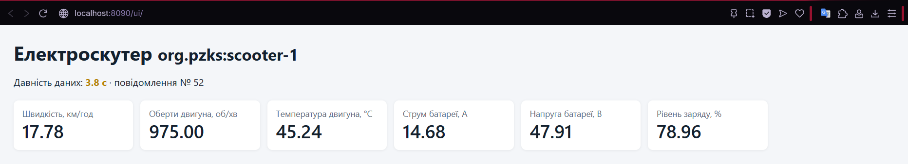

# Телеметрія цифрового двійника

## Схема повідомлення

Для передавання телеметрії від емулятора сенсорів електроскутера до платформи цифрового двійника використовується протокол MQTT.

Повідомлення публікуються у форматі JSON з такими параметрами:

- **MQTT-брокер:** `localhost:1883`;
- **Тема:** `pzks/scooter-1/telemetry`;
- **QoS:** `1`;
- **Формат даних:** JSON;
- **Період передавання:** 1 повідомлення за секунду за стандартних параметрів запуску емулятора.

Повідомлення містить номер послідовності `seq`, час отримання відліку `ts` та значення сенсорів у скороченому форматі, наближеному до формату реальних пристроїв і шлюзів.

### Структура полів

| Поле | Величина | Одиниця вимірювання | Тип даних | Діапазон | Точність |
|---|---|---|---|---|---|
| `seq` | Номер повідомлення | – | integer | від 1 | 1 |
| `ts` | Час відліку (Unix timestamp) | мс | integer | Unix epoch milliseconds | 1 мс |
| `v` | Швидкість руху | км/год | float | 0–50 | 0,01 |
| `rpm` | Частота обертання двигуна | об/хв | integer | 0–3000 | 1 |
| `i` | Струм акумулятора | А | float | 0–50 | 0,01 |
| `u` | Напруга акумулятора | В | float | 36–54,6 | 0,01 |
| `temp` | Температура двигуна | °C | float | -20–120 | 0,01 |
| `soc` | Рівень заряду акумулятора | % | float | 0–100 | 0,01 |
| `brk` | Стан гальмування | – | boolean | true / false | – |
| `lck` | Стан блокування | – | boolean | true / false | – |

Точність у таблиці характеризує роздільну здатність значень, які формує емулятор, тобто кількість десяткових знаків. Вона не є характеристикою метрологічної точності реального сенсора.

### Приклад повідомлення

```json
{
  "seq": 1,
  "ts": 1794140000000,
  "v": 27.35,
  "rpm": 1504,
  "i": 19.12,
  "u": 48.05,
  "temp": 48.42,
  "soc": 80.0,
  "brk": false,
  "lck": false
}
```

Значення в прикладі наведені для демонстрації структури повідомлення.

## Запис вихідної телеметрії

Кожне сформоване повідомлення додатково записується у файл `results/source.csv`. Файл містить ті самі поля, що й MQTT-повідомлення, включно з номером послідовності та часовою міткою.

CSV-файл використовується як джерело вихідних даних для перевірки узгодженості між опублікованою телеметрією та станом цифрового двійника.

Для перевірки роботи емулятора використовується команда:

```bash
python emulator/emulator.py --rate 1 --count 5
```

У результаті емулятор формує та публікує п'ять повідомлень із частотою один раз на секунду, одночасно записуючи їх у `results/source.csv`.

## Відповідність рекомендаціям IEEE 2888.1

Під час опису телеметрії враховано підхід до представлення сенсорних даних: для кожного вимірюваного параметра визначено його назву, фізичну величину, одиницю вимірювання, тип даних і допустимий діапазон значень.

Скорочені назви полів використовуються для передавання даних у форматі, наближеному до повідомлень реальних пристроїв.

---

# Вебподання поточного стану цифрового двійника

Для відображення поточного стану цифрового двійника електроскутера реалізовано вебінтерфейс `ui/index.html`.

Вебподання отримує початковий стан двійника HTTP-запитом до API Eclipse Ditto, а подальші зміни отримує через потік подій SSE (Server-Sent Events) через проксі `web`.

У вебінтерфейсі відображаються такі параметри електроскутера:

- швидкість руху, км/год;
- частота обертання двигуна, об/хв;
- температура двигуна, °C;
- струм акумулятора, А;
- напруга акумулятора, В;
- рівень заряду акумулятора, %.

## Реалізовані рішення

У вебподанні реалізовано три рішення, розглянуті на лекції.

### 1. Збереження останнього відомого стану

Отримані значення телеметрії відображаються у відповідних картках інтерфейсу. Функція `apply(features)` оновлює значення лише тоді, коли відповідна властивість присутня в отриманих даних.

Якщо надходження нових повідомлень припиняється, останні отримані значення залишаються на екрані. Таким чином, користувач може бачити останній відомий стан електроскутера навіть за відсутності нової телеметрії.

### 2. Відображення давності даних

Для визначення давності використовується час останнього відліку `sync.ts`, який зберігається у властивостях цифрового двійника.

Давність обчислюється як різниця між поточним часом і часовою міткою останнього вимірювання. Результат відображається в секундах.

Для візуального позначення актуальності даних використовується три кольори:

- **Зелений:** давність менше 2 секунд;
- **Жовтий:** давність від 2 до 10 секунд;
- **Червоний:** давність понад 10 секунд.

Це дає змогу швидко визначити, наскільки актуальними є показники цифрового двійника.

### 3. Незалежна частота оновлення подання

Оновлення інтерфейсу не залежить безпосередньо від частоти надходження телеметрії.

Для періодичного оновлення індикатора давності використовується функція `setInterval()` з інтервалом 250 мс. Отже, індикатор оновлюється чотири рази на секунду, навіть якщо нові повідомлення надходять лише один раз на секунду.

Це дає змогу постійно відображати актуальну давність даних незалежно від частоти надходження вимірювань.

## Перевірка роботи вебінтерфейсу

Для перевірки роботи вебподання емулятор сенсорів запускається без обмеження кількості повідомлень:

```bash
python emulator/emulator.py --rate 1
```

Після запуску емулятора відкривається вебінтерфейс за адресою:

```text
http://localhost:8090/ui/
```

Під час роботи емулятора значення телеметрії оновлюються щосекунди, а давність даних залишається меншою за 2 секунди та позначається зеленим кольором.

Після зупинки емулятора за допомогою `Ctrl+C` нові повідомлення перестають надходити, тому давність даних поступово зростає. Через 2 секунди індикатор стає жовтим, а через 10 секунд — червоним. При цьому останні отримані значення телеметрії залишаються відображеними в інтерфейсі.

Таким чином, перевіряється збереження останнього відомого стану, відображення давності даних і незалежне оновлення вебподання.

## Результат роботи

На рисунку наведено вебінтерфейс цифрового двійника електроскутера `org.pzks:scooter-1` з відображенням значень телеметрії, номера останнього повідомлення та давності даних.

